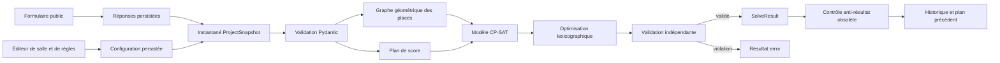
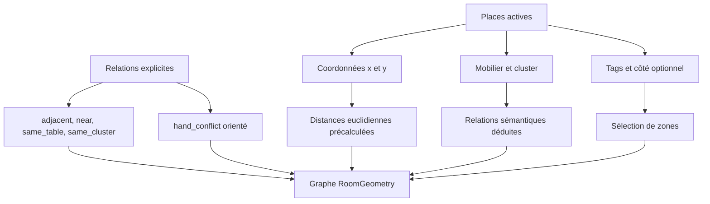
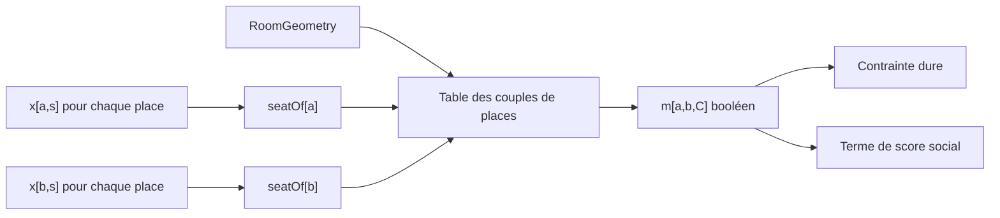
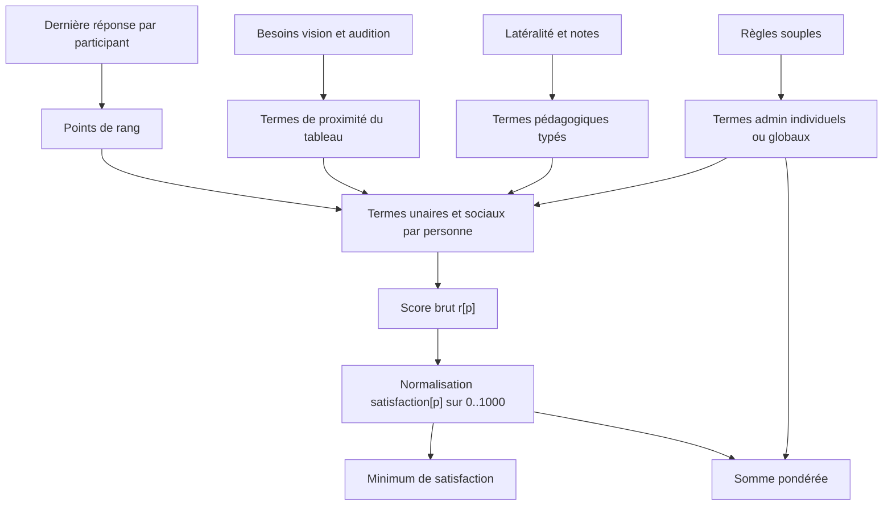
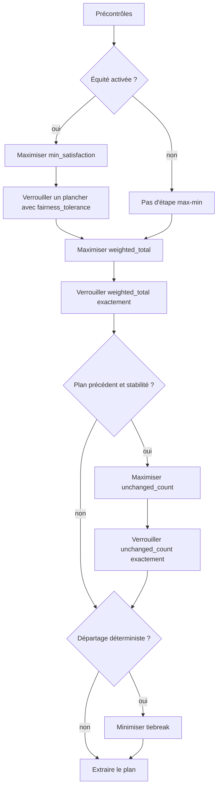
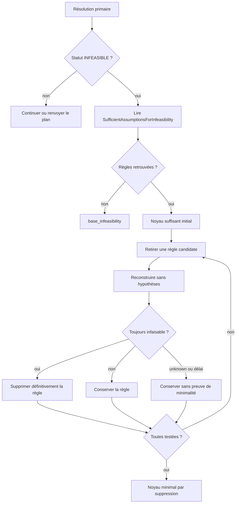
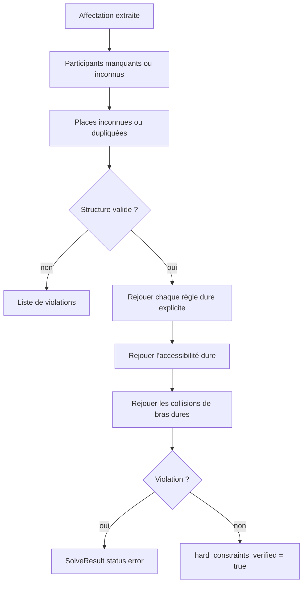
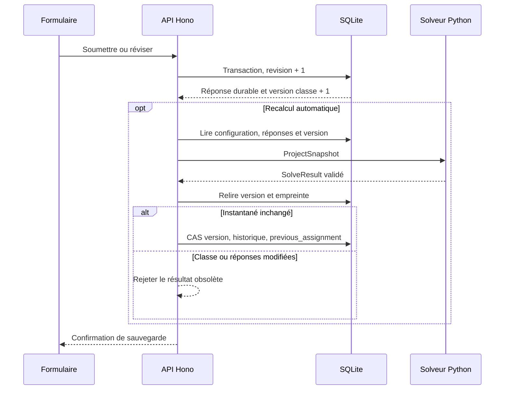

# Moteur de placement : modèle, objectifs et garanties

Ce document décrit le moteur réellement exécuté par Plan2Classe. Il ne s'agit
pas d'une présentation théorique d'un solveur possible : les notations et les
formules ci-dessous correspondent à l'implémentation dans
[`engine.py`](../services/solver/app/solver/engine.py),
[`geometry.py`](../services/solver/app/solver/geometry.py),
[`scoring.py`](../services/solver/app/solver/scoring.py) et
[`validation.py`](../services/solver/app/solver/validation.py).

Le problème est une affectation injective de personnes à des places, enrichie
de relations entre places, de contraintes pédagogiques et d'une optimisation
lexicographique. Il est résolu exactement, sous limite de temps, avec
**OR-Tools CP-SAT**.

## 1. Vue d'ensemble

L'API applicative construit un instantané JSON complet de la classe. Le service
Python ne lit ni la base SQLite ni les comptes : il transforme cet instantané
en modèle CP-SAT, exécute les objectifs successifs, puis vérifie le plan avec un
second chemin de code avant de renvoyer le résultat.



Les garanties principales sont les suivantes :

- toute personne active reçoit exactement une place active ;
- une place active reçoit au plus une personne ;
- toutes les règles dures doivent être vraies ;
- si l'équité est activée, le minimum de satisfaction est traité avant le
  total pondéré ;
- la stabilité et le départage ne peuvent pas dégrader les objectifs primaires
  déjà verrouillés ;
- un plan annoncé comme faisable passe un validateur indépendant du modèle
  CP-SAT.

En revanche, `optimal` ne signifie pas « meilleur selon tous les critères
imaginables ». Il signifie que les **étapes primaires exécutées** ont été
prouvées optimales. Une étape optionnelle de stabilité ou de départage peut
avoir expiré sans invalider ce statut.

## 2. Données prises en compte

### 2.1 Ensembles et notation

On note :

- \(P\), l'ensemble des participants dont `active == true` ;
- \(S\), l'ensemble des places dont `enabled == true` ;
- \(T\), l'ensemble des identifiants de mobilier référencés par au moins une
  place active ;
- \(R_h\), les règles activées et dures ;
- \(R_s\), les règles activées et souples.

Les participants inactifs et les places désactivées sont absents du modèle.
Les identifiants de participants doivent être uniques. Les identifiants de
places doivent être uniques et les relations de salle doivent viser des places
existantes. Une réponse doit viser un participant existant et ne peut classer
que des places actives ; ces invariants sont vérifiés par les modèles Pydantic
avant le lancement de CP-SAT.

### 2.2 Précontrôles de capacité

Avant de construire le modèle, trois erreurs simples sont détectées :

1. aucun participant actif ;
2. aucune place active ;
3. \(|P| > |S|\).

Le résultat est alors immédiatement `infeasible`, avec respectivement un
diagnostic `empty_project`, `empty_room` ou `capacity`. Cette étape évite de
demander à CP-SAT de démontrer une impossibilité évidente.

### 2.3 Réponses et révisions

Le solveur accepte défensivement plusieurs réponses pour une même personne.
`build_scoring_plan` conserve celle dont le couple
`(revision, submitted_at)` est lexicographiquement maximal. À égalité parfaite,
la dernière occurrence parcourue remplace la précédente.

Dans l'application, une seule ligne existe normalement par couple
classe/participant. Une modification :

- incrémente `revision` ;
- conserve `firstSubmittedAt` ;
- recopie cette date initiale dans `submitted_at` envoyé au solveur.

Ainsi, modifier ses choix ne permet pas de regagner une meilleure priorité
d'arrivée et ne fait pas perdre celle déjà acquise.

## 3. La salle comme graphe géométrique et sémantique

Le moteur ne suppose ni des rangées régulières, ni des tables rectangulaires,
ni un nombre fixe de places par table. Chaque place possède des coordonnées,
des tags et, éventuellement, un mobilier et un cluster. Les arêtes explicites
complètent les relations déduites de la géométrie.



### 3.1 Distance entre deux places

Pour deux places \(s_a=(x_a,y_a)\) et \(s_b=(x_b,y_b)\), la distance est :

\[
d(s_a,s_b)=\sqrt{(x_a-x_b)^2+(y_a-y_b)^2}.
\]

Toutes les distances ordonnées sont précalculées. Les relations ont ensuite la
sémantique exacte suivante :

| Relation | Vraie lorsque… |
| --- | --- |
| `adjacent` | une arête explicite existe, ou les deux places appartiennent au même mobilier et leur distance est au plus `infer_adjacent_threshold` ; |
| `near` | une arête explicite existe, ou la distance est au plus `near_threshold` ; |
| `same_table` | les deux places ont le même `furniture_id` non nul, ou une arête explicite `same_table` existe ; |
| `same_cluster` | elles ont le même `cluster_id` non nul, ou une arête explicite `same_cluster` existe ; |
| `hand_conflict` | l'arête orientée `place gauche -> place droite` existe explicitement ou a été inférée. |

Les relations explicites marquées bidirectionnelles sont copiées dans les deux
sens, sauf `hand_conflict`, qui reste toujours orientée. Une proximité entre
deux tables séparées par une allée n'est donc inférée que par la distance pour
`near` ; une adjacency entre ces tables doit être dessinée explicitement.

### 3.2 Distance au tableau et zone avant

Le point de référence du tableau est son centre horizontal à la coordonnée
verticale `board.y` :

\[
d_B(s)=\sqrt{\left(x_s-\left(x_B+\frac{w_B}{2}\right)\right)^2
                 +(y_s-y_B)^2}.
\]

La rotation du tableau et les obstacles visuels ne sont pas modélisés. Le score
de proximité, entier entre 0 et 1000, est :

\[
front(s)=\operatorname{clamp}_{0}^{1000}
\left(\operatorname{round}\left(1000\left(1-\frac{d_B(s)}
{\max(1,\max_{u\in S}d_B(u))}\right)\right)\right).
\]

Pour une fraction avant \(f\), le moteur retient
\(\max(1,\lceil |S|f\rceil)\) places, triées par `(distance au tableau,
identifiant)`. Une contrainte d'accessibilité utilise comme seuil la plus grande
distance de cet ensemble. Des places à la même distance que le seuil peuvent
donc aussi être autorisées même si elles n'étaient pas dans les premières du
tri.

### 3.3 Collision de bras directionnelle

Une collision vise le cas précis « droitier sur la place physiquement à gauche
d'un gaucher sur la place physiquement à droite ». Si les côtés `left` et
`right` sont renseignés, ils sont prioritaires. Sinon :

1. le moteur calcule le vecteur allant du milieu des deux places vers le centre
   du tableau ;
2. il en déduit l'axe latéral droit de l'occupant ;
3. il projette le vecteur entre les places sur les axes latéral et longitudinal ;
4. il ne crée une arête que si la séparation est davantage latérale que
   longitudinale.

Cette construction fonctionne aussi pour une rangée tournée vers un tableau
qui n'est pas strictement au-dessus à l'écran. Les places doivent appartenir au
même mobilier et être adjacentes pour qu'une collision soit inférée.

### 3.4 Tags de places

`seats_with_tags(tags, mode)` construit un ensemble de places :

- `mode == "all"` : tous les tags demandés doivent être présents ;
- toute autre valeur, dont `"any"` : au moins un tag doit être présent.

Avec une liste vide, `all` sélectionne toutes les places et `any` n'en
sélectionne aucune. Les interfaces produisent normalement des paramètres
valides, mais cette conséquence de la sémantique ensembliste est importante
pour les imports directs.

## 4. Variables CP-SAT et linéarisation

### 4.1 Variables d'affectation

Pour chaque \(p\in P\) et \(s\in S\), le modèle crée :

\[
x_{p,s}\in\{0,1\},
\]

où \(x_{p,s}=1\) signifie que la personne \(p\) occupe la place \(s\).

Les contraintes structurelles sont :

\[
\forall p\in P,\quad \sum_{s\in S}x_{p,s}=1,
\]

\[
\forall s\in S,\quad \sum_{p\in P}x_{p,s}\leq 1.
\]

Le nombre de variables booléennes d'affectation est donc exactement
\(|P|\times|S|\).

### 4.2 Variable entière de place

Les places reçoivent un indice stable suivant leur ordre dans l'instantané. Pour
chaque personne, une variable entière est liée aux booléens :

\[
seatOf_p=\sum_{s\in S}index(s)\,x_{p,s}.
\]

`seatOf` permet de représenter une relation entre deux affectations sans
multiplier deux variables booléennes pour chaque couple de places.

### 4.3 Variable de condition entre deux personnes

Pour un couple de personnes et une condition \(C\), le moteur crée à la demande
un booléen \(m_{a,b,C}\). Une table autorisée contient, pour chaque couple de
places, le triplet :

\[
(index(s_a), index(s_b), \mathbb{1}[C(s_a,s_b)]).
\]

`AddAllowedAssignments([seatOf_a, seatOf_b, m], tuples)` impose alors
l'équivalence exacte entre l'affectation et la valeur de `m`.



Une condition non directionnelle met d'abord les identifiants de personnes
dans l'ordre afin de partager la même variable entre règles identiques. Une
condition `hand_conflict` conserve l'ordre droitier/gaucher. Le cache est indexé
par les deux personnes et par `(kind, relation, threshold, negate)`.

Cette linéarisation utilise une variable par condition distincte, mais sa table
contient \(|S|^2\) lignes. Pour \(K\) conditions sociales distinctes, la taille
de cette partie du modèle est donc en \(O(K|S|^2)\).

## 5. Contraintes dures

Chaque règle dure est protégée par un littéral d'hypothèse propre. Les
contraintes suivantes sont ajoutées avec `OnlyEnforceIf(assumption)` afin que
CP-SAT puisse ensuite identifier les règles responsables d'une contradiction.

### 5.1 Règles canoniques

| Type | Traduction exacte |
| --- | --- |
| `fixed_seat` | impose \(x_{p,s}=1\) ; une référence absente rend la règle contradictoire ; |
| `forbidden_seats` | impose \(x_{p,s}=0\) pour chaque couple participant/place existant cité ; |
| `require_seat_tags` | la somme des \(x_{p,s}\) sur les places correspondant aux tags vaut 1 ; aucune place correspondante rend la règle contradictoire ; |
| `forbid_seat_tags` | impose \(x_{p,s}=0\) sur toutes les places correspondant aux tags ; |
| `pair_relation` | impose \(m_{a,b,C}=1\) si `required`, sinon \(m_{a,b,C}=0\) ; |
| `group_same_table` | impose `same_table` pour chaque paire du groupe ; |
| `group_different_tables` | interdit `same_table` pour chaque paire du groupe ; |
| `min_distance` | impose \(d(s_a,s_b)\geq distance\) ; |
| `max_distance` | impose \(d(s_a,s_b)\leq distance\) ; |
| `tag_not_adjacent` | pour chaque paire ayant la même valeur du `tag_key` ciblé, interdit `adjacent` ; |
| `max_tag_per_table` | pour chaque mobilier, limite à `max_count` le nombre de personnes portant `tag_key == tag_value` ; |
| `table_tag_balance` | sur chaque mobilier et pour chaque paire de valeurs ciblées, impose que l'écart absolu de leurs effectifs soit au plus `max_difference`. |

Pour `tag_not_adjacent`, une liste `values` vide cible toutes les valeurs non
nulles ; sinon seules les valeurs listées sont concernées. Pour
`table_tag_balance`, une liste de valeurs vide est remplacée par toutes les
valeurs du tag observées chez les participants actifs.

Les règles de table itèrent uniquement sur les `furniture_id` présents. Une
place sans mobilier peut recevoir une personne, mais ne contribue pas aux
quotas ou à l'équilibrage par table.

### 5.2 Extensions conservées du POC

| Type | Traduction exacte |
| --- | --- |
| `group_spread_table` | pour chaque table, l'effectif du groupe est au plus `max_per_table` ; |
| `no_go` | interdit l'union des `seat_ids` explicites et des places correspondant aux tags selon `mode` ; |
| `alternate_tag` | sélectionne les participants ciblés, puis interdit la relation choisie pour chaque paire ; |
| `max_board_distance` | force la personne à choisir exactement une place dont \(d_B(s)\leq max_distance\). |

`alternate_tag` peut sélectionner soit un marqueur présent comme clé ou valeur
dans `person.tags`, soit un `tag_key` et, facultativement, certaines valeurs. La
relation peut être `adjacent`, `near`, `same_table` ou `same_cluster`.

### 5.3 Règles implicites typées

Deux réglages génèrent des règles système visibles dans les diagnostics :

- si `accessibility_hard` est actif, chaque personne dont
  `max(vision_need, hearing_need) >= 3` reçoit une règle
  `max_board_distance` fondée sur `hard_front_fraction` ;
- si `hand_collision == "hard"`, chaque couple droitier/gaucher reçoit une
  règle `pair_relation` interdisant la relation orientée `hand_conflict`.

Les personnes ambidextres ou de latéralité inconnue ne créent pas de règle de
collision.

### 5.4 Paramètre mal formé

Les paramètres des quatre extensions sont typés strictement dans les modèles.
Pour le reste, si la construction d'une règle dure rencontre une clé absente ou
une valeur invalide, elle ajoute une contradiction sous l'hypothèse de cette
règle : l'erreur devient diagnostiquable au lieu d'être ignorée. Une exception
notable est une entrée inconnue dans la liste de `forbidden_seats`, qui ne crée
simplement aucune variable à interdire.

## 6. Construction du score individuel

Le score est d'abord construit sous forme de termes unaires, dépendant de la
place d'une seule personne, et de termes binaires, dépendant d'une relation
entre deux personnes.



### 6.1 Décroissance par rang

Les douze premiers rangs, indexés à partir de zéro dans le code, valent :

```text
rang affiché       1    2    3    4    5    6    7    8    9   10   11   12
points            100   72   54   41   32   25   19   14   10    7    5    3
```

Au-delà, pour l'index de rang \(r\geq12\) :

\[
rankPoints(r)=\max\left(1,\operatorname{round}\left(\frac{100}{r+2}\right)\right).
\]

### 6.2 Priorité déclarée par la personne

`priority_mode` ne donne aucune priorité d'arrivée. Il module les catégories de
souhaits de cette réponse :

| Mode | multiplicateur place/zone | multiplicateur voisinage |
| --- | ---: | ---: |
| `seat` | 1,40 | 0,70 |
| `neighbors` | 0,70 | 1,40 |
| `balanced` ou `none` | 1,00 | 1,00 |

Les coefficients sont arrondis après multiplication :

\[
coefPlace=round(rankPoints\times seatPreferenceWeight\times m_{place}),
\]

\[
coefZone=round(rankPoints\times zonePreferenceWeight\times m_{place}),
\]

\[
coefVoisin=round(rankPoints\times neighborPreferenceWeight\times m_{voisin}),
\]

\[
coefEvitement=-round(rankPoints\times avoidNeighborWeight\times m_{voisin}).
\]

Un choix de place crée un terme sur cette place. Un choix de zone crée le même
terme sur chaque place active portant le tag. Un souhait ou un évitement crée un
terme activé si la relation demandée est vraie ; son bénéficiaire est la
personne ayant répondu.

### 6.3 Souhait réciproque

Si A demande B et B demande A pour la même relation, un unique terme
supplémentaire de coefficient `mutual_bonus` est créé. A et B en bénéficient
tous les deux. Il s'ajoute à leurs souhaits individuels et n'est créé qu'une
fois par paire et par relation.

### 6.4 Vision et audition en mode souple

Pour chaque personne :

\[
needWeight=visionNeed\times visionWeight
          +hearingNeed\times hearingWeight.
\]

Si ce poids est positif, chaque place reçoit le terme :

\[
coefAccess(p,s)=\max\left(0,
round\left(\frac{front(s)\times needWeight}{10}\right)\right).
\]

Ce terme participe au score normalisé et donc à l'équité, même si la personne
n'a pas rempli le formulaire. Activer `accessibility_hard` ajoute en plus la
contrainte de zone avant pour les besoins au moins égaux à 3 ; cela ne supprime
pas le terme souple.

### 6.5 Latéralité et niveaux

En mode `hand_collision == "soft"`, chaque couple droitier/gaucher reçoit un
terme de coefficient `-hand_collision_weight`, activé uniquement dans le sens
de collision. Les deux personnes sont bénéficiaires de la pénalité.

Si `grade_mix_weight > 0`, toute paire de personnes notées dont l'écart est au
moins `grade_mix_min_difference` reçoit un bonus `grade_mix_weight` lorsqu'elle
est adjacente. Les deux personnes bénéficient du bonus.

### 6.6 Traduction des règles souples

Une règle souple n'est jamais imposée. Elle est traduite comme suit :

| Type | Contribution lorsqu'elle est satisfaite ou violée |
| --- | --- |
| `fixed_seat` | `+weight` sur la place ciblée ; |
| `forbidden_seats`, `no_go`, `forbid_seat_tags` | `-weight` sur chaque place interdite ; |
| `require_seat_tags` | `+weight` sur chaque place correspondante ; |
| `pair_relation` | `+weight` si la relation requise est vraie, ou `-weight` si la relation interdite est vraie ; |
| `group_same_table` | `+weight` pour chaque paire à la même table ; |
| `group_different_tables` | `-weight` pour chaque paire à la même table ; |
| `min_distance`, `max_distance` | `+weight` si le seuil est respecté ; |
| `tag_not_adjacent`, `alternate_tag` | `-weight` pour chaque paire ciblée qui possède la relation interdite ; |
| `max_board_distance` | `+weight` pour une place située sous le seuil ; |
| `max_tag_per_table`, `table_tag_balance`, `group_spread_table` | pénalité globale proportionnelle au dépassement. |

Les règles sociales créditent ou pénalisent chacun de leurs bénéficiaires. Les
trois règles de cardinalité globale ne sont en revanche attribuées à aucune
personne : elles interviennent uniquement dans l'objectif total.

### 6.7 Pénalités globales

Pour `max_tag_per_table` ou `group_spread_table`, sur chaque table \(t\) :

\[
overflow_t\geq count_t-maximum,\qquad overflow_t\geq0,
\]

et l'objectif reçoit \(-weight\times overflow_t\). Comme le total est maximisé
et le poids est positif, la variable prend le plus petit dépassement possible.

Pour `table_tag_balance`, pour chaque table et paire de valeurs \(a,b\) :

\[
violation_{t,a,b}\geq |count_{t,a}-count_{t,b}|-allowed,
\]

avec la même pénalité `-weight * violation`.

L'équilibrage de notes est également global. Les notes sont converties en
centièmes \(g_p=round(100\times grade_p)\). Pour \(N\) personnes notées et
\(G=\sum g_p\), le moteur calcule sur chaque table :

\[
deviation_t=\left|N\sum_{p\text{ noté à }t}g_p
                    -G\times occupancy_t\right|,
\]

où `occupancy` ne compte que les personnes ayant une note. La contribution est
`-grade_balance_weight * deviation`. Une personne sans note n'affecte donc ni
la moyenne mondiale ni l'occupation utilisée dans cette formule.

## 7. Normalisation et équité

### 7.1 Score brut

Pour une personne \(p\), le score brut est la somme de ses termes actifs :

\[
r_p=\sum_i c_{p,i}v_i,
\]

où \(v_i\) est soit un booléen d'affectation \(x_{p,s}\), soit un booléen de
condition sociale. Les pénalités globales ne figurent pas dans \(r_p\).

### 7.2 Enveloppe de normalisation

Notons \(U_p(s)\) la somme de tous les coefficients unaires de \(p\) sur la
place \(s\), et \(Q_p\) le multiensemble des coefficients de ses termes
sociaux. Le moteur utilise :

\[
L_p=\min_{s\in S}U_p(s)+\sum_{q\in Q_p,\ q<0}q,
\]

\[
H_p=\max_{s\in S}U_p(s)+\sum_{q\in Q_p,\ q>0}q.
\]

La partie unaire est bornée exactement, puisqu'une seule place est choisie. La
partie sociale est volontairement conservatrice : elle suppose que toutes les
pénalités pourraient être actives pour la borne basse et tous les bonus pour la
borne haute, même si ces combinaisons ne sont pas géométriquement réalisables.
Il s'agit donc d'une **enveloppe sûre**, pas nécessairement du pire et du
meilleur score réellement atteignables par cette personne.

### 7.3 Satisfaction entière de 0 à 1000

Si \(H_p=L_p\), la satisfaction est fixée à 1000. Sinon :

\[
satisfaction_p=
\left\lfloor1000\times\frac{r_p-L_p}{H_p-L_p}\right\rfloor.
\]

CP-SAT encode exactement ce plancher avec les deux inégalités :

\[
s_p(H_p-L_p)\leq1000(r_p-L_p),
\]

\[
(s_p+1)(H_p-L_p)\geq1000(r_p-L_p)+1.
\]

Seules les personnes dont \(H_p>L_p\) contraignent le minimum de satisfaction.
Une personne sans aucun terme individuel reçoit 1000 et reste neutre dans
l'étape max-min. Elle est tout de même affectée à une place et compte dans les
contraintes structurelles et collectives.

### 7.4 Poids d'arrivée et priorité administrative

Le poids utilisé dans le total est :

\[
w_p=\max(1,round(1000\times factor_p\times priority_p)).
\]

`priority_p` est le champ administratif de la personne, compris entre 0,01 et
100. Pour les \(n\) personnes ayant répondu, triées par `submitted_at`, avec
une position \(k\) commençant à 0 et \(b=arrivalBonusPercent/100\) :

- `equal` ou absence de réponse : \(factor_p=1\) ;
- `linear` : \(factor_p=1+b\) si \(n=1\), sinon
  \(1+b\frac{n-1-k}{n-1}\) ;
- `exponential` :
  \(factor_p=1+b\exp(-k/\max(1,n/4))\).

Ce poids n'intervient **jamais** dans le minimum de satisfaction. L'arrivée et
la priorité ne départagent les solutions qu'au stade du total, après le
verrouillage de l'équité.

## 8. Objectifs lexicographiques

Le moteur reconstruit un modèle pour chaque étape. Après une résolution, la
valeur retenue devient une contrainte du modèle suivant.



### 8.1 Étape 1 — max-min fairness

Si `fairness_enabled`, le modèle maximise :

\[
m=\min_{p:H_p>L_p}satisfaction_p.
\]

Techniquement, `min_satisfaction` est borné au-dessus par chaque satisfaction
éligible ; sa maximisation le rend égal au minimum. S'il n'existe aucune
personne éligible, il vaut 1000.

À l'étape suivante, le verrou est un plancher, pas toujours une égalité :

\[
minSatisfaction\geq\max(0,m^*-fairnessTolerance).
\]

La valeur par défaut de `fairness_tolerance` est 0. Une valeur positive autorise
explicitement le total à sacrifier jusqu'à ce nombre de points sur l'échelle
0..1000.

### 8.2 Étape 2 — satisfaction pondérée

Le total maximisé est :

\[
weightedTotal=\sum_{p\in P}w_p\times satisfaction_p
              +\sum_j globalCoefficient_j\times globalVariable_j.
\]

Le premier terme contient les préférences, les règles souples attribuées à des
personnes, l'accessibilité souple, les collisions et le mix de niveaux. Le
second contient les dépassements collectifs et l'équilibrage de notes.

Après cette étape, `weighted_total` est verrouillé par égalité. Si l'équité est
désactivée, cette étape est le premier objectif ; la valeur de
`min_satisfaction` trouvée est mémorisée, mais le total reste le critère
primaire.

### 8.3 Étape 3 — stabilité

Si `stability_enabled` et si `previous_assignment` n'est pas vide :

\[
unchangedCount=\sum_{p:\ previous(p)\in S}x_{p,previous(p)}.
\]

Le moteur maximise ce nombre avec le total déjà fixé et le plancher d'équité
conservé. Les anciennes entrées visant une personne inactive ou une place
désactivée sont ignorées. La stabilité ne peut donc jamais acheter une baisse
du score primaire.

### 8.4 Étape 4 — départage déterministe

Pour les indices de personne \(i\) et de place \(j\), commençant à zéro :

\[
c_{i,j}=(((i+1)\times73856093)\oplus((j+1)\times19349663))\bmod1000003.
\]

Le dernier objectif minimise :

\[
tiebreak=\sum_{i,j}c_{i,j}x_{i,j}.
\]

Ces coefficients pseudo-aléatoires stables n'expriment aucune préférence pour
le haut, la gauche ou un identifiant particulier. Ils dépendent néanmoins de
l'ordre des personnes et des places dans l'instantané. Une collision de sommes
reste mathématiquement possible ; ce stade améliore donc fortement la
reproductibilité sans constituer une preuve d'unicité.

### 8.5 Temps, statuts et verrous

Le temps configuré est partagé à parts égales entre les étapes prévues :

\[
timePerStage=\max(0.25,\ timeLimit/numberOfStages).
\]

Le plancher de 0,25 seconde signifie que, pour une très petite limite, la somme
des limites d'étape peut dépasser `time_limit_seconds`. Chaque solveur reçoit
aussi le nombre de workers et la graine configurés.

Une étape primaire doit au moins retourner `FEASIBLE`. Si elle retourne :

- `INFEASIBLE`, le moteur lance le diagnostic de contradiction ;
- `UNKNOWN`, aucun plan n'est renvoyé et le diagnostic est `solver_timeout` ;
- `FEASIBLE`, le meilleur plan trouvé est conservé, mais le résultat global est
  `feasible` ;
- `OPTIMAL`, sa valeur est prouvée optimale dans ce modèle.

`primary_optimal` agrège uniquement l'étape max-min, lorsqu'elle existe, et
l'étape de total. Si une étape optionnelle échoue, le dernier plan primaire
valide est conservé et son statut d'étape porte la mention
`primary plan retained`.

Chaque `StageResult` expose le statut, la valeur, la meilleure borne CP-SAT,
l'écart relatif \(|bound-value|/\max(1,|value|)\), forcé à zéro pour `OPTIMAL`,
et le temps mural.

### 8.6 Indications de démarrage

Les affectations précédentes valides sont données à CP-SAT comme **hints**, sans
devenir des contraintes. Les places restantes sont suggérées gloutonnement en
traitant d'abord les personnes dont le meilleur score unaire est le plus élevé,
puis en choisissant leur meilleure place encore libre. CP-SAT peut entièrement
réparer ou ignorer ce démarrage si les règles de paire l'exigent.

## 9. Diagnostic d'infaisabilité

Le diagnostic comporte deux niveaux.



### 9.1 Noyau fourni par CP-SAT

Chaque règle dure, y compris les règles système d'accessibilité et de
latéralité, possède un littéral d'hypothèse. Lorsqu'un modèle est infaisable,
`SufficientAssumptionsForInfeasibility` retourne un sous-ensemble suffisant de
ces littéraux. S'il n'en contient aucun, l'impossibilité est attribuée à la
structure de base et le diagnostic est `base_infeasibility`.

### 9.2 Réduction par suppressions successives

À partir du noyau initial, le moteur teste chaque règle :

1. reconstruire le modèle sans cette règle et sans littéraux d'hypothèse ;
2. si le modèle reste infaisable, la règle n'est pas nécessaire et est retirée ;
3. si le modèle devient faisable, la règle est conservée ;
4. si le solveur répond `UNKNOWN`, `MODEL_INVALID` ou dépasse le délai, la règle
   est conservée mais la minimalité n'est pas revendiquée.

Le budget total de cette réduction est
`diagnostic_time_limit_seconds`. Chaque test reçoit au plus 0,8 seconde et le
temps de construction du modèle compte dans le même budget. Un test conclusif
terminant après l'échéance invalide lui aussi la revendication de minimalité.

`minimal_by_deletion == true` signifie que chaque règle restante est nécessaire
au regard des suppressions unitaires testées. Cela ne signifie pas que le noyau
a la cardinalité minimale parmi tous les noyaux possibles.

## 10. Validation indépendante après résolution

Une solution CP-SAT n'est pas publiée directement. `validate_assignment`
reconstruit `RoomGeometry` et contrôle le dictionnaire d'affectation sans
réutiliser les objets de contraintes du modèle.



Les contrôles structurels s'arrêtent tôt s'ils détectent une personne absente,
une personne inconnue, une place inconnue ou une place utilisée plusieurs fois.
Sinon, le validateur couvre tous les types de règles dures implémentés, puis les
deux familles de règles système.

Une violation post-résolution produit `status == "error"`, conserve
l'affectation pour le diagnostic, ajoute `post_solve_validation` et laisse
`hard_constraints_verified == false`. L'API Hono effectue encore un contrôle de
références, de complétude et de cohérence entre `assignment` et `people` ; elle
refuse également tout plan faisable dont `hard_constraints_verified` n'est pas
vrai.

## 11. Persistance, recalcul et concurrence

Le service Python est sans état. La cohérence entre réponses, configuration et
résultat est donc assurée à la frontière applicative.



Les protections concrètes sont :

- les soumissions sont sérialisées en mémoire par classe dans chaque processus
  API ;
- une soumission s'exécute dans une transaction et met à jour la version de la
  classe par compare-and-swap ;
- les calculs sont eux aussi sérialisés en mémoire par classe ;
- le service Python limite son processus à un calcul CP-SAT à la fois avec un
  sémaphore ;
- avant de persister une solution, l'API compare la version de classe et une
  empreinte de la configuration structurelle et des réponses
  `(id, revision, updatedAt)` ;
- la mise à jour finale de version est encore conditionnelle ; un instantané
  devenu obsolète produit `CONFLICT` au lieu d'écraser le nouvel état ;
- une réponse est déjà durable lorsque le recalcul automatique commence ; un
  échec du solveur n'annule donc pas la soumission ;
- une modification structurelle efface `previous_assignment` et les anciennes
  solutions ; le nettoyage des références obsolètes dans une réponse utilise
  un compare-and-swap sur `(id, classroomId, revision, updatedAt)` et relit la
  révision récente après un conflit.

Les files en mémoire ne sont pas des verrous distribués. En cas de plusieurs
réplicas, ce sont les empreintes, les transactions et les compare-and-swap en
base qui empêchent la persistance d'un résultat périmé.

Une solution faisable ou optimale devient `previous_assignment` pour le
prochain calcul. L'historique est borné aux 50 solutions les plus récentes par
classe.

## 12. Lecture du résultat

Pour chaque personne, `PersonResult` contient :

- la place retenue ;
- le score brut ;
- la satisfaction normalisée ;
- l'indicateur de réponse reçue ;
- l'indicateur de déplacement par rapport au plan précédent ;
- le détail des termes individuels effectivement actifs, triés par valeur
  absolue décroissante.

Le détail n'inclut pas les pénalités globales de cardinalité ni l'équilibrage
des notes, car ces termes n'ont pas de bénéficiaire individuel. Les agrégats
`min_satisfaction` et `average_satisfaction` du résultat final ne retiennent que
les personnes ayant répondu ou possédant au moins un terme actif dans leur
`breakdown`. Si la liste est vide, les deux valeurs valent 1000.

`model_stats` expose notamment :

- le nombre de participants et de places actifs ;
- le nombre de règles dures, règles système comprises ;
- le nombre de répondants ;
- \(|P||S|\) booléens d'affectation ;
- le nombre de booléens de relation distincts ;
- le nombre de termes individuels évaluables.

## 13. Complexité et limites connues

L'affectation simple est polynomiale, mais les règles relationnelles, les
cardinalités et les objectifs successifs produisent un problème combinatoire
général. CP-SAT explore donc potentiellement un espace exponentiel ; la limite
de temps est une propriété normale du service, pas un garde-fou exceptionnel.

Les principaux facteurs de taille sont :

- \(|P||S|\) booléens d'affectation ;
- une variable entière `seatOf` par personne ;
- une variable booléenne et une table de \(|S|^2\) lignes par condition sociale
  distincte ;
- un nouveau modèle et une nouvelle résolution pour chaque objectif ;
- jusqu'à plusieurs reconstructions supplémentaires pour réduire un noyau
  contradictoire.

Les limites à garder en tête sont :

- la distance au tableau vise un point, sans rotation, obstacles ni visibilité ;
- l'adjacence entre mobiliers n'est jamais déduite automatiquement ;
- les quotas « par table » ignorent les places sans `furniture_id` ;
- la normalisation sociale utilise des bornes conservatrices, pas une
  optimisation individuelle exacte ;
- le départage dépend de l'ordre d'entrée et peut théoriquement connaître une
  collision ;
- plusieurs workers peuvent accélérer CP-SAT, mais la reproductibilité la plus
  stricte est obtenue avec un worker, une graine fixe et une étape de départage
  achevée ;
- un statut `feasible` garantit un plan vérifié, mais pas la preuve d'optimalité
  des objectifs primaires.

## 14. Paramètres par défaut

Les valeurs ci-dessous sont celles de `SolverSettings`. Une classe peut les
modifier, mais connaître l'échelle initiale aide à interpréter un score ou un
poids dans l'interface.

| Paramètre | Défaut | Rôle |
| --- | ---: | --- |
| `time_limit_seconds` | 12,0 | budget réparti entre les étapes ; |
| `num_workers` | 1 | workers CP-SAT ; un worker favorise la reproductibilité ; |
| `random_seed` | 20260822 | graine transmise à chaque étape ; |
| `fairness_enabled` | `true` | active l'étape max-min ; |
| `fairness_tolerance` | 0 | perte de minimum admise avant le total ; |
| `arrival_policy` | `equal` | politique de pondération des répondants ; |
| `arrival_bonus_percent` | 35 | amplitude de `linear` ou `exponential` ; |
| `seat_preference_weight` | 100 | échelle des choix de place ; |
| `neighbor_preference_weight` | 100 | échelle des voisins souhaités ; |
| `avoid_neighbor_weight` | 130 | échelle des voisins à éviter ; |
| `zone_preference_weight` | 45 | échelle des zones ; |
| `mutual_bonus` | 30 | bonus ajouté à chaque bénéficiaire d'un souhait réciproque ; |
| `stability_enabled` | `true` | active l'objectif de conservation du plan ; |
| `deterministic_tiebreak` | `true` | active le dernier objectif pseudo-aléatoire stable ; |
| `diagnostic_time_limit_seconds` | 8,0 | budget de réduction d'un noyau contradictoire ; |
| `accessibility_hard` | `false` | rend la zone avant obligatoire à partir d'un besoin de 3 ; |
| `hard_front_fraction` | 0,32 | fraction servant à construire cette zone ; |
| `vision_weight` | 8 | poids unitaire du besoin visuel ; |
| `hearing_weight` | 6 | poids unitaire du besoin auditif ; |
| `hand_collision` | `hard` | traitement par défaut des collisions droitier/gaucher ; |
| `hand_collision_weight` | 500 | pénalité utilisée uniquement en mode `soft` ; |
| `grade_balance_weight` | 0 | équilibrage global des notes, désactivé par défaut ; |
| `grade_mix_weight` | 0 | bonus de mix adjacent, désactivé par défaut ; |
| `grade_mix_min_difference` | 2,0 | écart minimal de note pour ce bonus. |

`auto_solve_on_response` vaut aussi `true` par défaut, mais il est consommé par
l'API pour décider de lancer un recalcul ; il ne modifie pas le modèle CP-SAT.
`default_relation` vaut `adjacent` dans le contrat actuel, mais le moteur
emploie la relation portée par chaque réponse ou règle et ne lit pas directement
ce réglage.

Les valeurs typées par défaut d'une personne sont `priority = 1`, besoins
vision/audition à 0, aucune note et latéralité `unknown`.

## 15. Tests qui matérialisent ces garanties

La suite Python compare notamment le solveur à une énumération exhaustive sur
un petit cas, puis couvre :

- l'optimum lexicographique max-min puis total ;
- les personnes sans réponse ;
- la priorité d'arrivée après équité ;
- la stabilité d'un plan équivalent ;
- les relations explicites et les tables libres ;
- les règles canoniques et les quatre extensions ;
- l'accessibilité, les collisions directionnelles et les notes ;
- le noyau contradictoire et la prudence en cas de délai de réduction ;
- le validateur indépendant ;
- le contrat HTTP du service.

Les tests TypeScript couvrent en plus la conservation de `firstSubmittedAt`,
l'incrément de révision, le nettoyage concurrent par compare-and-swap et le
refus de persister une résolution calculée sur un état devenu obsolète.

Depuis la racine du dépôt :

```bash
bun run test
```

Pour cibler uniquement le solveur :

```bash
cd services/solver
pytest -q
```

## 16. Ajouter une nouvelle règle sans rompre les garanties

Une extension complète doit suivre tous les chemins, pas seulement ajouter une
contrainte CP-SAT :

1. définir et valider son contrat dans les modèles Python et le schéma
   TypeScript ;
2. ajouter sa traduction dure dans `_add_hard_rule` avec le littéral
   d'hypothèse ;
3. ajouter sa traduction souple dans `build_scoring_plan` ou dans les termes
   globaux ;
4. définir clairement si elle bénéficie à une personne, à deux personnes ou
   seulement au total collectif ;
5. l'implémenter séparément dans `validate_assignment` ;
6. ajouter au minimum un test faisable, un test infaisable, un test souple et un
   test de validation indépendante ;
7. documenter son effet sur l'enveloppe de normalisation, les diagnostics et la
   complexité.

Cette symétrie entre modélisation, explication et validation est ce qui permet à
Plan2Classe de ne pas seulement produire un plan, mais d'indiquer pourquoi il a
été retenu et pourquoi il peut être considéré comme sûr.
